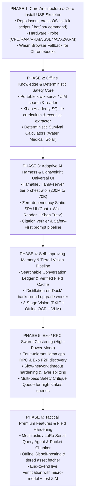

# Product & Architecture Requirements Document (PRD / ARD)
## OffGridUSB (offgridusb.com): Universal Offline Knowledge & Adaptive AI Harness

> **Document Status:** v1.0 — Product & Architecture Specification  
> **Target Audience:** Product Team, Engineering, Field Testing & Competitive Strategy  
> **Core Mandate:** Zero-install, single-click offline human knowledge (Wikipedia, WikiMed, Khan Academy) + adaptive AI that runs on **anything** from an ESP32 thin client, locked-down Chromebook, Raspberry Pi, or 10-year-old laptop up to a scavenged `exo` cluster or multi-GPU supercomputer.

---

## 1. Executive Summary & Competitive Counter-Positioning

Existing offline survival and knowledge platforms fail when confronted with real-world grid-down hardware scavenging:
- **Project N.O.M.A.D.** assumes a pre-configured x86 Ubuntu/Debian server with Docker and Docker Compose installed. Its knowledge apps (Kiwix, Kolibri) and AI (Ollama) are siloed into separate tabs with no unified intelligence harness.
- **Off-Grid AI (`offgridai.io`)** provides static survival PDFs wrapped in a standard local LLM chat app without dynamic hardware clustering, interactive K-12/engineering curricula, or long-range radio mesh integration.

### Competitive Counter-Advertising Matrix

| Capability | Project N.O.M.A.D. | Off-Grid AI (`offgridai.io`) | **OffGridUSB (`offgridusb.com`)** | **Counter-Marketing Hook** |
| :--- | :--- | :--- | :--- | :--- |
| **Deployment & Boot** | Requires Linux + Docker setup | App install per device | **1-Click Zero-Install off USB (+ Browser Wasm fallback)** | *"Don't spend 3 hours installing Docker in an emergency. Plug in and click once."* |
| **Old / Locked Hardware** | Fails on 4GB RAM, no SSE4 fallback, no Chromebook | Fails on very low-spec / locked OS | **Runs on 10-yr-old 4GB laptops, ARM Pis, and Chromebooks** | *"Works on the computers you actually find, not just the server you wished you bought."* |
| **Supercomputer & Swarm Scaling** | Single-node only | Single-device only | **Auto-scales to 35B–70B+ OR pools junk laptops via `exo` / RPC** | *"Turn 4 scavenged laptops into 1 supercomputer over any cable or Wi-Fi."* |
| **Knowledge Harness** | Siloed apps (manual copy-paste) | Static PDFs | **Active RAG over Wikipedia (`.zim`), WikiMed & Khan Academy** | *"An AI that actually reads Wikipedia and teaches Khan Academy with verified citations."* |
| **Self-Improving Memory** | Stateless or basic chat history | Basic chat history | **Persistent SQLite Memory + "Distillation-on-Dock"** | *"Gets smarter every time you use it—and keeps 70B insights even when moved to a 4GB laptop."* |
| **Vision / Photo Analysis** | Manual model setup | Basic VLM on high-end | **Tiered OCR + Micro-VLM (~250MB) up to Frontier Vision** | *"Snap a pill bottle, circuit board, or plant on any hardware."* |
| **Remote Field Access** | Local Wi-Fi only (~100 ft) | Local screen only | **LoRa / Meshtastic Asynchronous Query Agent (Miles)** | *"Leave the brain at Base Camp. Query it from 5 miles away on a pocket radio."* |

---

## 2. Product Tiers & Feature Sets

To support both open community adoption and a high-value commercial/tactical offering, features are organized into **Core**, **Pro (Field Engineer)**, and **Tactical / Apex (Premium)**.


---

## 3. Universal Hardware & OS Compatibility Matrix ("ARM to Old Laptop to Chrome to Supercomputer")

The system uses a **3-Layer Execution Fallback** so no hardware is ever left behind:

| Target Hardware | OS / Environment | Execution Engine | Active Model Tier | Vision Engine |
| :--- | :--- | :--- | :--- | :--- |
| **ESP32 / Microcontroller** | Bare-metal / Meshtastic | **Thin Client Protocol** (Serial / HTTP / LoRa) | Queries nearest host or offline keyword lookup | Camera capture relay (ESP32-CAM) |
| **Locked Chromebook / Tablet / Any Browser** | ChromeOS, iPadOS, Android, locked Windows | **Layer 3: Pure Browser Wasm** (`wllama` WebAssembly + browser ZIM reader) | **Tier 0:** 135M–360M Q4 in browser RAM | Browser Wasm OCR + lightweight classifier |
| **Raspberry Pi Zero 2 / Pi 4 / Pi 5 / ARM SBC** | Linux ARM64 (`aarch64`) | **Layer 1: Native ARM64 Portable Binary** (`llamafile` / `llama-server` + `kiwix-serve`) | **Tier 0–1:** 200M–360M (Pi Zero 2) to 1.7B–3B (Pi 4/5) | Offline OCR + Micro-VLM (~250 MB) |
| **10-Year-Old Laptop (4–8 GB RAM, SSE4.2 / AVX)** | Windows 7/10/11, old Ubuntu, macOS | **Layer 1: Polyglot / Baseline x86_64 Binary** (SSE4 safe fallback) | **Tier 1:** 0.5B–1.5B (400MB–1GB RAM) | Offline OCR + Micro-VLM |
| **Modern Laptop / Mini-PC (16–32 GB RAM)** | Windows, macOS (Metal), Linux (Vulkan/CUDA/ROCm) | **Layer 1: Accelerated Native Binary** | **Tier 2:** 7B–12B | 1.8B–3B Vision-Language Model |
| **Scavenged Swarm (2–8 Weak Machines on LAN)** | Mixed Windows + Mac + Linux + Pi | **Layer 2: Exo / `llama.cpp` RPC Cluster** (Latency-tolerant pipeline) | **Tier 3:** Distributed 30B–35B MoE / Dense | 7B+ Vision distributed |
| **Supercomputer / Workstation (64–512 GB / Multi-GPU)** | Linux / Windows Server / macOS Studio | **Layer 1: Multi-GPU Server Mode** (Multi-user settlement hub) | **Tier 4:** 35B–70B+ | 32B–72B Frontier Vision |

---

## 4. Architecture Requirements Document (ARD) — Core Subsystems

### 4.1 Self-Improving Memory & "Distillation-on-Dock"
1. **Episodic Memory Ledger (Full-Text Searchable on USB):**
   - Every prompt, retrieved Wikipedia/Khan passage, photo analysis, and final response is logged with timestamps, topic tags, and verification status.
2. **Semantic "Field Knowledge Cache":**
   - Before a small model (e.g., 200M–500M on an old laptop) answers a question, the harness searches **both** Wikipedia/Khan Academy **and** the local verified memory store.
3. **"Distillation-on-Dock" (Background Upgrade Engine):**
   - Complex or low-confidence queries recorded on low-spec hardware are queued in `pending_deep_review`.
   - When the USB docks into a strong machine, `exo` cluster, or supercomputer, a background worker replays queued questions against a high-tier model, cross-checks retrieved references, and writes a **Verified Master Note** back to the USB database—preserving high-tier intelligence when returned to low-spec hardware.

### 4.2 Tiered Vision & Photo Intelligence Pipeline
1. **Stage 1 — Deterministic Extraction (All Tiers):** Extracts EXIF/GPS metadata and runs offline OCR to read pill bottles, serial numbers, wiring labels, and book pages in <1–2 seconds with minimal RAM.
2. **Stage 2 — Micro-VLM (Low/Mid Spec):** Lightweight multimodal GGUF (~250MB–1GB) for scene description and object/plant/component identification.
3. **Stage 3 — Frontier VLM (High Spec):** Deep schematic, medical atlas, and map analysis.
4. **Persistent Visual Memory:** Every photo's OCR text, metadata, and VLM analysis is permanently indexed on disk so even devices running with zero vision model retain full search and recall over the photo library.

### 4.3 Exo & RPC Distributed Clustering (Speed-Agnostic, Safety-First)
1. **Dual Backend Coordination (`exo` + `llama.cpp` RPC):** Supports heterogeneous peer discovery (`exo`) and ultra-lightweight C++ layer-splitting (`rpc-server`) transmitting only small activation tensors per token so slow or degraded network connections remain usable.
2. **High-Latency / Drop Resilience:** Extended socket timeouts, retry backoff, and automatic graceful fallback to local inference if peer nodes disconnect.
3. **Safety-Over-Speed Consensus Audit:** Multi-pass verification checks numerical claims, dosages, and warnings in generated drafts directly against retrieved source passages, flagging any unsupported statement.

### 4.4 Remote Mesh Query Agent (Premium Tactical Tier)
- Listens on Serial/TCP for Meshtastic / LoRa radio frames (`@ai <query>`, `@calc <type> <args>`, `@log <note>`).
- Compresses grounded answers into compact `<= 200`-byte numbered packets (`[1/N]`) with ACK/retry state tracking so field operators miles from Base Camp can query the knowledge engine asynchronously.

---

## 5. Gated Waterfall Rollout Plan



---

## 6. USB Build, Filesystem & Multi-Drive Provisioning Architecture

- **Recommended Filesystem:** **`exFAT` (`128 KB` allocation unit size)** so single `.zim` (`4.6 GB` Khan Academy, `50 GB` / `110 GB` Wikipedia) and `.gguf` (`3B`–`70B`) files exceed FAT32's 4.0 GB ceiling while remaining natively readable/writable across Windows, macOS, Linux, Raspberry Pi OS, and ChromeOS.
- **Zero-Install Runtime Packaging:** Pure Python `3.12.8` Embeddable (`bin/windows_x86_64/python/`) + `kiwix-serve` (`:8081`) + native `llama-server` (`:8082`) + Cosmopolitan `llamafile` + POSIX `/tmp/emyrge_runtime/` auto-extraction for `noexec` USB mounts.
- **Automated Tooling (`scripts/`):**
  - `DOWNLOAD_INTERNET_IN_A_BOX.bat` / `scripts/download_internet_in_a_box.ps1` / `scripts/download_internet_in_a_box.sh` — Resumable HTTP byte-range provisioning with `ZIM\x04` and `GGUF` binary magic-header verification.
  - `FORMAT_AND_SETUP_USB.bat` / `scripts/format_and_setup_usb.ps1` / `scripts/setup_usb_unix.sh` — Hard OS-drive safety blocks + guided `exFAT` formatting.
  - `MAKE_USB_DRIVES.bat` / `scripts/clone_to_usb.ps1` — 16-thread `robocopy /MT:16` mass-cloning (`< 45s` per Tier 0 USB stick).

---

## 7. Document Sign-Off & Credits

```text
   ____   __  __  _____      _     _ _    _  _____ ____  
  / __ \ / _|/ _|/ ____|    (_)   | | |  | |/ ____|  _ \ 
 | |  | | |_| |_| |  __ _ __ _  __| | |  | | (___ | |_) |
 | |  | |  _|  _| | |_ | '__| |/ _` | |  | |\___ \|  _ < 
 | |__| | | | | | |__| | |  | | (_| | |__| |____) | |_) |
  \____/|_| |_|  \_____|_|  |_|\__,_|\____/|_____/|____/ 
```

- **Signed — Lead Creator & Architect:** [**@TheBlindHacker**](https://github.com/TheBlindHacker)
- **Core Contributors:** [**@johndikeman**](https://github.com/johndikeman) (*John*), [**@organized-nick**](https://github.com/organized-nick) (*Nick*)
- **Team:** **The OffGridUSB Product, Security & Field Engineering Team** ([`offgridusb.com`](https://offgridusb.com) • [`github.com/TheBlindHacker/offgridUSB.com`](https://github.com/TheBlindHacker/offgridUSB.com))
- **Support & Official Pre-Built Drives:** Please visit **[https://offgridusb.com](https://offgridusb.com)** to purchase a ready-to-run OffGridUSB drive and support ongoing open-source engineering!

