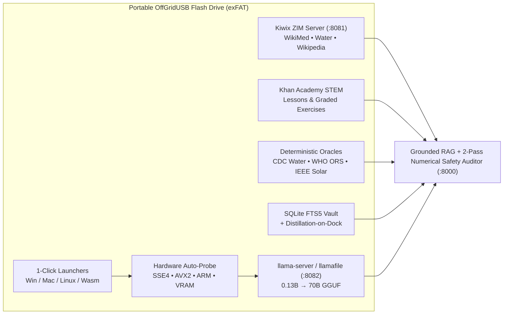

<div align="center">

### **[⚡ PLEASE VISIT OFFGRIDUSB.COM — Purchase an Official Ready-to-Run USB Drive & Support Our Team! →](https://offgridusb.com)**

[](https://offgridusb.com)
[](https://offgridusb.com)

[](https://offgridusb.com)

# OffGridUSB ([`offgridusb.com`](https://offgridusb.com))
### Universal Offline Knowledge, Internet-in-a-Box & Hardware-Adaptive AI Harness

**Zero Docker • Zero Cloud • Zero Installation • Single-Click Portable USB • 100% Air-Gapped**

[](#1-1-click-quick-start-using-a-ready-offgridusb-stick)
[](#3-internet-in-a-box--elastic-ai-catalog-tier-0--tier-4)
[](docs/HARDWARE_AND_FILESYSTEM_GUIDE.md)
[](#5-architecture--core-subsystems)

</div>

```text
    ____   __  __  _____      _     _ _    _  _____ ____       ___________________
   / __ \ / _|/ _|/ ____|    (_)   | | |  | |/ ____|  _ \     |  _______________  |====+
  | |  | | |_| |_| |  __ _ __ _  __| | |  | | (___ | |_) |    | | AI 0.13B->70B | |::::|
  | |  | |  _|  _| | |_ | '__| |/ _` | |  | |\___ \|  _ <     | | ZIM + KHAN DB | |::::|
  | |__| | | | | | |__| | |  | | (_| | |__| |____) | |_) |    | |_______________| |====+
   \____/|_| |_|  \_____|_|  |_|\__,_|\____/|_____/|____/      \_________________/
   PLUG IN  •  CLICK ONCE  •  TURN WI-FI OFF  •  REBUILD SCHOOLS, CLINICS & GRIDS
```

**OffGridUSB** ([offgridusb.com](https://offgridusb.com)) turns any ordinary USB flash drive or portable SSD into a self-contained **Internet-in-a-Box encyclopedia, STEM schoolhouse, life-safety engineering toolkit, and hardware-adaptive AI command center**.

Most "offline AI" or survival server projects fail the moment an actual grid-down outage happens: they expect a dedicated Ubuntu machine with Docker Compose pre-installed, crash on older 4 GB laptops lacking AVX2 instructions, cannot run on locked-down Chromebooks, and leave Wikipedia and local LLMs siloed in separate tabs where raw models hallucinate medical dosages and electrical math.

**OffGridUSB boots directly off the USB stick with a single click** across **Windows (`x64` & `ARM64`), macOS (`Apple Silicon` & `Intel`), Linux, Raspberry Pi (`ARM64`), and locked Chromebooks (`Pure-Browser WebAssembly`)**—automatically probing the host CPU/RAM/VRAM and scaling from a 512 MB SBC up to a scavenged multi-laptop `exo`/`llama.cpp` RPC cluster or 70B workstation.

---

## Our Origin Story — Who, Why, Where & When

- **Who:** Three off-grid builders, hackers, and unapologetic end-of-the-world fans—[**@TheBlindHacker**](https://github.com/TheBlindHacker), [**@johndikeman**](https://github.com/johndikeman), and [**@organized-nick**](https://github.com/organized-nick)—who looked at the modern cloud AI boom and asked the obvious question: *"Awesome... now what happens five minutes after the grid goes dark?"*
- **Why:** Because when cell towers go silent and fiber gets cut, `apt-get install` and Docker Compose are paperweights, and an LLM guessing at water-purification bleach drops is dangerous. We wanted humanity's survival, medical, solar, and STEM playbook—paired with grounded, zero-hallucination math and adaptive local AI—sealed onto something pocket-sized, offline, and dead simple.
- **Where:** On an ordinary USB stick, built for the hardware you *actually* find when things go sideways: a 10-year-old 4 GB laptop in a cabin, a solar-fed Raspberry Pi in a rucksack, a locked-down school Chromebook, or four mismatched scavenged laptops lashed together over an Ethernet cord into a makeshift supercomputer.
- **When:** Forged in October 2026—*before* Day Zero—so whether "the end of the world" turns out to be a two-week storm blackout, a backcountry camp 50 miles past the last bar of signal, or the real-deal apocalypse, you can **[grab a ready-made stick at OffGridUSB.com](https://offgridusb.com)** (or build one below), plug it in, click once, and reboot civilization.

> ### 🛒 Support Our Mission — Purchase an Official Pre-Built OffGridUSB Drive!
> Don't want to spend hours downloading `50 GB`–`110 GB` of Wikipedia, Khan Academy STEM, and AI weights—or want a **rugged, factory-tested, plug-and-play OffGridUSB flash drive or portable SSD** ready for your go-bag, family, cabin, classroom, or field clinic?
>
> 👉 **[Please Visit https://offgridusb.com and Buy One Today to Support Us!](https://offgridusb.com)**  
> *Every single OffGridUSB drive purchased directly supports our team (`@TheBlindHacker`, `@johndikeman`, and `@organized-nick`) and funds free open-source offline knowledge tools, hardware testing, and community survival releases.*

---

## Table of Contents

- [Our Origin Story — Who, Why, Where & When](#our-origin-story--who-why-where--when)
1. [1-Click Quick Start (Using a Ready OffGridUSB Stick)](#1-1-click-quick-start-using-a-ready-offgridusb-stick)
2. [Build Your Own OffGridUSB From Scratch (3 Steps)](#2-build-your-own-offgridusb-from-scratch-3-steps)
   - [Step 1 — Choose & Prepare Your USB Hardware (`exFAT` Guide)](#step-1--choose--prepare-your-usb-hardware-exfat-guide)
   - [Step 2 — Download Internet-in-a-Box (`.zim`), Portable Engines & AI Models](#step-2--download-internet-in-a-box-zim-portable-engines--ai-models)
   - [Step 3 — Format & Provision Your USB Drive(s)](#step-3--format--provision-your-usb-drives)
3. [Internet-in-a-Box & Elastic AI Catalog (`Tier 0` → `Tier 4`)](#3-internet-in-a-box--elastic-ai-catalog-tier-0--tier-4)
4. [Adding Custom Kiwix ZIM Libraries & Hugging Face GGUF Models](#4-adding-custom-kiwix-zim-libraries--hugging-face-gguf-models)
5. [Architecture & Core Subsystems](#5-architecture--core-subsystems)
6. [How OffGridUSB Compares to Project N.O.M.A.D. & Off-Grid AI](#6-how-offgridusb-compares-to-project-nomad--off-grid-ai)
7. [Repository & USB Directory Map](#7-repository--usb-directory-map)
8. [CLI Reference, LAN Sharing & Troubleshooting](#8-cli-reference-lan-sharing--troubleshooting)
9. [Authors, Contributors & OffGridUSB Team](#9-authors-contributors--offgridusb-team)

---

## 1. 1-Click Quick Start (Using a Ready OffGridUSB Stick)

Once your USB drive is provisioned, turn **Wi-Fi OFF / Airplane Mode ON** if desired, open the USB drive, and double-click the starter for your machine:

| Host Device / Operating System | 1-Click Primary Launcher | CLI / Custom Port Equivalent |
| :--- | :--- | :--- |
| **Windows 10 / 11 (`x86_64` & `ARM64`)** | Double-click **`START_OFFGRIDUSB_WINDOWS.bat`** *(or `START_EMYRGE_WINDOWS.bat`)* | `run_windows.bat --port 8000` |
| **macOS (`Apple Silicon M1–M4` & `Intel`)** | Double-click **`START_OFFGRIDUSB_MAC.command`** *(or `START_EMYRGE_MAC.command`)* | `./run_macos.command --port 8000` |
| **Linux & Raspberry Pi (`x86_64` & `ARM64`)** | Run **`./START_OFFGRIDUSB_LINUX.sh`** *(or `./START_EMYRGE_LINUX.sh`)* | `./run_linux.sh --port 8000` |
| **Locked Chromebook / Tablet (No Exec Rights)** | Open **`web/static/wasm/chromebook.html`** in Chrome | Pure-Browser WebAssembly Mode |

Once launched, three local services come online automatically with **zero WAN internet traffic**:
- **`http://127.0.0.1:8000`** — **OffGridUSB Command Center** (Grounded AI Professor, Internet-in-a-Box Reader, Khan Academy STEM Tutor, CDC/WHO/IEEE Calculators, SQLite Memory Vault, Visual OCR Vault, and Swarm Planner).
- **`http://127.0.0.1:8081`** — **Embedded `kiwix-serve` ZIM Library** (full offline search & browsing across all `.zim` encyclopedias in [`data/zim/`](data/zim/README.md)).
- **`http://127.0.0.1:8082`** — **Local `llama-server` / `llamafile` GGUF Engine** (auto-tuned thread count & context window for your probed hardware tier).

---

## 2. Build Your Own OffGridUSB From Scratch (3 Steps)

Because GitHub repositories do not store multi-gigabyte Wikipedia `.zim` archives or `.gguf` neural weights directly in Git history, this repository ships with **automated cross-platform provisioning, header verification, safe `exFAT` formatting, and 16-thread mass-cloning scripts** so anyone can build an air-gapped OffGridUSB drive in minutes.

### Step 1 — Choose & Prepare Your USB Hardware (`exFAT` Guide)

Match your flash drive or portable SSD to the knowledge & AI tier you want to carry (see **[`docs/HARDWARE_AND_FILESYSTEM_GUIDE.md`](docs/HARDWARE_AND_FILESYSTEM_GUIDE.md)** for full NAND & SSD benchmarks):

| USB Capacity | Recommended Build Tier | What Fits on the Drive | Required Filesystem |
| :--- | :--- | :--- | :--- |
| **8 GB – 16 GB** | **Tier 0 (Pocket Survival)** | Cross-OS engines + Safe Water + Field Medicine + WikiMed Mini + `Qwen2.5-0.5B` AI (~1.1 GB total) | **`exFAT`** *(or `FAT32`)* |
| **16 GB – 32 GB** | **Tier 1 (Legacy PC & Pi 4/5)** | Tier 0 + `SmolLM2-135M` + `Qwen2.5-1.5B` AI (~2.2 GB total) | **`exFAT`** *(or `FAT32`)* |
| **64 GB – 128 GB** | **Tier 2 (Full School + Wiki)** | Tier 1 + **Khan Academy STEM (4.6 GB)** + **Full English Wikipedia (50 GB)** + `Llama-3.2-3B` (~59 GB) | **`exFAT` REQUIRED** |
| **128 GB – 256 GB** | **Tier 3 (Scavenged Swarm)** | Tier 2 + **`Qwen2.5-32B` Distributed Swarm Model** (~78 GB total) | **`exFAT` REQUIRED** |
| **256 GB – 512 GB+** | **Tier 4 (Settlement Hub SSD)** | **Illustrated English Wikipedia Maxi (110 GB)** + **`Llama-3.3-70B` Frontier AI** (~230 GB total) | **`exFAT` REQUIRED** |

> **Why `exFAT` (`128 KB` Cluster Size) Is Strongly Recommended:**  
> Factory 8 GB–32 GB USB sticks often ship formatted as **FAT32**, which has a hard **4.0 GB single-file limit**. Full Wikipedia (`50 GB` / `110 GB`), Khan Academy (`4.6 GB`), and `3B+` AI models exceed 4 GB and **cannot copy onto FAT32**. Formatting as **`exFAT`** with a `128 KB` allocation unit works natively across **Windows, macOS, Linux, Raspberry Pi OS, and ChromeOS** with zero file-size ceiling and 15–35% faster sequential `.gguf`/`.zim` streaming.

Clone this repository onto any machine with internet access:

```bash
git clone https://github.com/TheBlindHacker/offgridUSB.com.git
cd offgridUSB.com
```

---

### Step 2 — Download Internet-in-a-Box (`.zim`), Portable Engines & AI Models

Our provisioning scripts ([`scripts/README.md`](scripts/README.md)) automatically fetch and magic-header-verify:
1. **Zero-Install Cross-Platform Engines ([`bin/`](bin/README.md)):** Portable Python `3.12.8` Embeddable (Windows), `kiwix-tools 3.8.1` (`kiwix-serve` for Windows, Linux `x86_64`, Raspberry Pi `ARM64`, and macOS), `llama.cpp` (`llama-server` for Windows `x64`/`ARM64`, Linux `x64`/`ARM64`, macOS Apple Silicon & Intel), and Mozilla's polyglot `llamafile`.
2. **Internet-in-a-Box OpenZIM Libraries ([`data/zim/`](data/zim/README.md)):** Official offline encyclopedias from `download.kiwix.org` verified via `ZIM\x04` magic headers.
3. **Offline GGUF AI Models ([`data/models/`](data/models/README.md)):** Quantized `Q4_K_M` instruction models verified via `GGUF` magic headers.

*(All downloads use resumable HTTP byte-ranges via `curl -C -`, so interrupted multi-gigabyte Wikipedia downloads resume cleanly!)*

#### Option A: Windows (1-Click Interactive Wizard or PowerShell CLI)

Double-click **`DOWNLOAD_INTERNET_IN_A_BOX.bat`** for the interactive tier menu, **or** run in PowerShell:

```powershell
# Tier 0 Pocket Survival Pack (~1.1 GB — fastest way to build & test your first USB)
.\scripts\download_internet_in_a_box.ps1 -Tier 0 -NonInteractive

# Tier 2 Full Civilization & STEM Schoolhouse (~59 GB — adds Khan Academy + 50GB English Wikipedia)
.\scripts\download_internet_in_a_box.ps1 -Tier 2 -NonInteractive

# Verify all staged engines, .zim headers, and .gguf models on disk
.\scripts\download_internet_in_a_box.ps1 -Verify
```

#### Option B: Linux, Raspberry Pi & macOS (Bash CLI)

```bash
chmod +x scripts/*.sh *.sh *.command

# Tier 0 Pocket Survival Pack (~1.1 GB — includes cross-OS binaries so the USB works everywhere)
./scripts/download_internet_in_a_box.sh --tier 0

# Tier 2 Full Civilization Pack (~59 GB — adds Khan Academy + 50GB English Wikipedia)
./scripts/download_internet_in_a_box.sh --tier 2

# Optional: Stage binaries ONLY for your current OS/CPU to save ~90 MB of USB space
./scripts/download_internet_in_a_box.sh --tier 0 --current-os-only

# Verify all staged .zim and .gguf files
./scripts/download_internet_in_a_box.sh --verify
```

#### Option C: Pure Python Standard-Library Manifest Provisioner (Any OS)

```bash
# Verify staged models & ZIM archives against manifests/models.json and manifests/zim.json
PYTHONPATH=src python3 -m emyrge.assets.fetch_assets --verify

# Preview planned downloads for Tier 2 without downloading
PYTHONPATH=src python3 -m emyrge.assets.fetch_assets --dry-run --tier 2
```

---

### Step 3 — Format & Provision Your USB Drive(s)

Every OffGridUSB formatting and cloning script includes **hard safety blocks** that refuse to format or overwrite `C:`, `/`, `/System`, `/boot`, `/dev/disk0`, or any OS boot/system partition.

#### On Windows

- **Format (`exFAT` / `FAT32`) + Full Setup Wizard:**  
  Plug in your USB drive and double-click **`FORMAT_AND_SETUP_USB.bat`** (runs [`scripts/format_and_setup_usb.ps1`](scripts/format_and_setup_usb.ps1)).
  - Displays physical USB bus info, capacity, and current filesystem.
  - Offers **`[1] Format as exFAT (128 KB allocation units — Recommended)`**, **`[2] Format as FAT32`**, or **`[3] Keep Existing Filesystem (Non-Destructive Copy)`**.
  - Automatically checks if any staged `.zim`/`.gguf` exceeds 4 GB so you never waste time copying onto FAT32, requires explicit typed confirmation (`FORMAT E`) before erasing, and runs 16-thread `robocopy /MT:16`.

- **Mass-Clone 2, 5, or 20 Identical USB Drives (`< 45 Seconds` per Stick):**  
  Already have formatted USB drives ready? Double-click **`MAKE_USB_DRIVES.bat`** (runs [`scripts/clone_to_usb.ps1`](scripts/clone_to_usb.ps1)). After each stick finishes, swap in the next flash drive and press **`Y`** to clone another copy immediately.

#### On Linux & macOS

Use [`scripts/setup_usb_unix.sh`](scripts/setup_usb_unix.sh) to inspect external drives, format as `exFAT`, and sync the runtime cleanly:

```bash
# 1. Inspect connected external USB drives and mountpoints
./scripts/setup_usb_unix.sh --list

# 2A. Format an external USB drive as exFAT (DESTRUCTIVE — requires typing 'FORMAT <dev>')
./scripts/setup_usb_unix.sh --format-exfat /dev/disk4 --label OFFGRIDUSB    # macOS
./scripts/setup_usb_unix.sh --format-exfat /dev/sdb1 --label OFFGRIDUSB     # Linux (exfatprogs)

# 2B. Or non-destructively copy/update OffGridUSB onto an already-mounted USB drive:
./scripts/setup_usb_unix.sh --copy /Volumes/OFFGRIDUSB                      # macOS
./scripts/setup_usb_unix.sh --copy /media/$USER/OFFGRIDUSB                  # Ubuntu / Debian / Pi OS
```

---

## 3. Internet-in-a-Box & Elastic AI Catalog (`Tier 0` → `Tier 4`)

### Built-In Internet-in-a-Box OpenZIM Packs ([`manifests/zim.json`](manifests/zim.json))

| Tier | Manifest ID | Archive Title | Approx. Size | Primary Use Case |
| :---: | :--- | :--- | :---: | :--- |
| **0** | `zimgit-water` | **ZimGit Safe Water & Emergency Sanitation Manual** | `20 MB` | Filtration, chlorination, solar disinfection, well & latrine construction |
| **0** | `zimgit-medicine` | **ZimGit Austere Field Medicine & First Aid** | `67 MB` | Trauma care, wound management, dental/austere clinical procedures |
| **0** | `wikipedia-medicine-mini` | **Wikipedia English Medicine Mini** | `166 MB` | Offline pharmacology, triage, pathology & clinical reference |
| **2** | `khanacademy-en` | **Khan Academy Offline STEM & K-12 Complete Pack** | `4.6 GB` | Full offline math, physics, chemistry, electrical & biology lessons |
| **2** | `wikipedia-en-nopic-50gb` | **Full English Wikipedia (Compact No-Pictures Edition)** | `50.0 GB` | Every article in English Wikipedia (~6.8M+ articles) for 64GB+ USBs |
| **4** | `wikipedia-en-maxi-110gb` | **Full Illustrated English Wikipedia (Maxi Edition)** | `110.0 GB` | Complete Wikipedia with diagrams, anatomy plates & maps for 256GB+ SSDs |

### Built-In Elastic GGUF Model Ladder ([`manifests/models.json`](manifests/models.json))

| Tier | Manifest ID | Model (`Q4_K_M`) | Disk Size | Min RAM | Target Hardware & Prompting Strategy |
| :---: | :--- | :--- | :---: | :---: | :--- |
| **0** | `smollm2-135m-q4` | `SmolLM2-135M-Instruct` | `101 MB` | `512 MB` | Chromebook Wasm / Raspberry Pi Zero 2 (`search_then_summarize`) |
| **0** | `qwen2.5-0.5b-q4` | `Qwen2.5-0.5B-Instruct` *(Default)* | `469 MB` | `1 GB` | Universal instant-boot USB baseline (`search_then_summarize`) |
| **1** | `qwen2.5-1.5b-instruct-q4` | `Qwen2.5-1.5B-Instruct` | `1.06 GB` | `3 GB` | 10-year-old 4 GB SSE4.2 laptops & Raspberry Pi 4/5 (`search_then_summarize`) |
| **2** | `llama-3.2-3b-instruct-q4` | `Llama-3.2-3B-Instruct` | `1.93 GB` | `8 GB` | Modern AVX2 / Apple Metal / CUDA / Vulkan laptops (`tool_calling`) |
| **3** | `qwen2.5-32b-instruct-q4` | `Qwen2.5-32B-Instruct` | `18.9 GB` | `24 GB` | Pooled RAM across 2–8 weak LAN machines via `exo` / `llama.cpp` RPC (`tool_calling`) |
| **4** | `llama-3.3-70b-instruct-q4` | `Llama-3.3-70B-Instruct` | `40.6 GB` | `64 GB` | Multi-GPU Settlement Hub & "Distillation-on-Dock" teacher (`tool_calling`) |

---

## 4. Adding Custom Kiwix ZIM Libraries & Hugging Face GGUF Models

OffGridUSB uses **automatic runtime discovery**—you never need to edit code to expand your USB drive:

1. **Drop-In `.zim` Encyclopedias (iFixit, Stack Overflow, Project Gutenberg, MDWiki):**
   - Download any `.zim` archive from **[library.kiwix.org](https://library.kiwix.org/)** or **[download.kiwix.org/zim/](https://download.kiwix.org/zim/)** and place it into **[`data/zim/`](data/zim/README.md)**.
   - `KiwixRunner` validates the `ZIM\x04` header, mounts it on `:8081`, and indexes live search hits into the AI Professor RAG pipeline automatically.
2. **Drop-In `.gguf` Neural Weights:**
   - Place any `.gguf` file from Hugging Face into **[`data/models/`](data/models/README.md)**. `ModelRunner` verifies the `GGUF` magic header and binds it automatically.

---

## 5. Architecture & Core Subsystems



1. **Grounded AI Professor + 2-Pass Numerical Safety Audit:** Retrieves passages across offline ZIM encyclopedias, Khan Academy STEM lessons, and Verified Master Notes with clickable `[Source: ...]` citations, then runs a deterministic **2-Pass Numerical Claim Auditor** (`SourceAudit`) that flags any dosage or measurement not backed by retrieved sources.
2. **Internet-in-a-Box (`kiwix-serve` + Native ZIM Reader + Khan Academy Tutor):** Hosts real `.zim` archives alongside interactive STEM lessons and graded practice exercises—plus a zero-AI **Direct Lookup Mode** for sub-millisecond battery-saving retrieval.
3. **Zero-Hallucination Life-Safety Calculators:** Pure-Python deterministic engines for **CDC/WHO Emergency Water Chlorination**, **WHO Oral Rehydration & Pediatric Dosing**, **IEEE 1562 Off-Grid Solar & LiFePO4 Battery Sizing**, and **NEC DC Voltage Drop / Ohm's Law**.
4. **Self-Improving SQLite FTS5 Memory & "Distillation-on-Dock":** Uncertain field queries asked on weak 4 GB laptops are flagged in [`data/vault/memory.sqlite`](data/vault/README.md). Whenever the USB stick later docks with a high-spec workstation or cluster, queued questions are upgraded into permanent **Verified Master Field Notes** on the USB drive.
5. **Visual Field Vault:** Offline binary PNG/JPEG/EXIF/GPS parser and OCR indexing ([`data/uploads/`](data/uploads/README.md)) so photos of pill bottles, wiring plates, and schematics remain full-text searchable on zero-GPU hardware.
6. **Exo & `llama.cpp` RPC Scavenged Swarm + LoRa Mesh Framing:** Pools heterogeneous LAN laptops into a distributed 32B cluster with crash-free local fallback if a node disconnects.

See **[`docs/PRD_ARD.md`](docs/PRD_ARD.md)**, **[`docs/HARDWARE_AND_FILESYSTEM_GUIDE.md`](docs/HARDWARE_AND_FILESYSTEM_GUIDE.md)**, and **[`CONTRIBUTING.md`](CONTRIBUTING.md)** for full technical specifications.

---

## 6. How OffGridUSB Compares to Project N.O.M.A.D. & Off-Grid AI

| Capability | Project N.O.M.A.D. | Off-Grid AI (`offgridai.io`) | **OffGridUSB (`offgridusb.com`)** |
| :--- | :--- | :--- | :--- |
| **Setup & Boot** | Linux OS + Docker Compose install | Per-device app install | **1-Click Zero-Install off USB (+ Wasm Browser Mode)** |
| **Hardware Elasticity** | Fails on old 4 GB / non-AVX2 PCs | Static local model | **Probes SSE4/AVX2/AVX-512/ARM/VRAM (`Tier -1` to `Tier 4`)** |
| **Knowledge Grounding** | Siloed Kiwix & Ollama tabs | Static survival PDFs | **Unified RAG over ZIM Encyclopedias + Khan Academy** |
| **Life-Safety Math** | Raw LLM (hallucination risk) | Raw LLM | **Deterministic CDC/WHO/IEEE Calculators + 2-Pass Audit** |
| **Self-Improving USB** | Stateless | Basic chat history | **SQLite FTS5 Vault + "Distillation-on-Dock" Upgrades** |
| **Scavenged Swarm** | Single-node only | Single-device only | **Pools mismatched laptops via `exo` & `llama.cpp` RPC** |

---

## 7. Repository & USB Directory Map

Every folder includes its own local `README.md` guide so cloned repositories and provisioned USB sticks are self-documenting offline:

```text
OFFGRIDUSB/
├── START_OFFGRIDUSB_WINDOWS.bat       # 1-Click Windows launcher (auto-opens browser + LAN IP)
├── START_OFFGRIDUSB_MAC.command       # 1-Click macOS launcher (Apple Silicon & Intel)
├── START_OFFGRIDUSB_LINUX.sh          # 1-Click Linux & Raspberry Pi launcher
├── DOWNLOAD_INTERNET_IN_A_BOX.bat     # 1-Click Windows Internet-in-a-Box & AI downloader
├── FORMAT_AND_SETUP_USB.bat           # 1-Click Windows safe USB formatter (exFAT/FAT32) & setup
├── MAKE_USB_DRIVES.bat                # 1-Click multi-USB mass cloner (< 45s per drive)
├── run_windows.bat / run_linux.sh / run_macos.command
├── docs/                              # Architecture & hardware documentation
│   ├── assets/offgridusb-banner.svg   # Vector hero illustration (100% offline SVG)
│   ├── PRD_ARD.md                     # Product & Architecture Requirements Specification
│   └── HARDWARE_AND_FILESYSTEM_GUIDE.md
├── manifests/                         # Declarative Tier 0–4 catalogs (manifests/README.md)
│   ├── zim.json                       # OpenZIM Internet-in-a-Box catalog
│   └── models.json                    # Quantized GGUF model catalog (0.13B -> 70B)
├── scripts/                           # Provisioning & cloning suite (scripts/README.md)
│   ├── download_internet_in_a_box.ps1 # Resumable Windows asset + engine provisioner (CRLF)
│   ├── download_internet_in_a_box.sh  # Resumable Linux / Raspberry Pi / macOS provisioner (LF)
│   ├── format_and_setup_usb.ps1       # Safe Windows exFAT/FAT32 formatter & provisioner (CRLF)
│   ├── clone_to_usb.ps1               # 16-thread Robocopy multi-USB mass cloner (CRLF)
│   └── setup_usb_unix.sh              # Safe Linux & macOS exFAT formatter & rsync cloner (LF)
├── bin/                               # Zero-install native engines (bin/README.md)
│   ├── windows_x86_64/ & windows_arm64/
│   ├── linux_x86_64/   & linux_arm64/
│   ├── macos_arm64/    & macos_x86_64/
│   └── polyglot/                      # Cosmopolitan llamafile universal fallback
├── data/                              # Offline content & persistent vaults (data/README.md)
│   ├── zim/                           # *.zim Internet-in-a-Box offline encyclopedias
│   ├── models/                        # *.gguf quantized offline LLM weights
│   ├── vault/                         # Persistent SQLite FTS5 memory & Master Notes
│   └── uploads/                       # Field photos indexed by offline EXIF + OCR Vault
├── src/emyrge/                        # 100% pure Python stdlib backend (zero pip dependencies!)
└── web/static/                        # Offline SPA + pure-browser Chromebook Wasm shell
```

---

## 8. CLI Reference, LAN Sharing & Troubleshooting

- **Share With Phones & Tablets Over Base-Camp Wi-Fi (Zero App Install):**  
  `START_OFFGRIDUSB_WINDOWS.bat`, `START_OFFGRIDUSB_MAC.command`, and `START_OFFGRIDUSB_LINUX.sh` bind `--host 0.0.0.0` so any phone, tablet, or peer laptop on the same local router/hotspot (with zero WAN internet) can open `http://<HOST_LAN_IP>:8000`. For localhost-only mode, run `./run_linux.sh --host 127.0.0.1 --port 8000`.
- **macOS Gatekeeper Tip:**  
  If macOS flags scripts downloaded from a browser archive, clear quarantine once in Terminal:
  ```bash
  xattr -dr com.apple.quarantine .
  chmod +x *.command *.sh scripts/*.sh
  ```
- **Linux USB Mounted `noexec` (`FAT32` / `exFAT`):**  
  `KiwixRunner` and `ModelRunner` automatically detect `noexec` USB mounts and transparently stage/extract native `.tar.gz` binaries + `.so` symlinks into `/tmp/emyrge_runtime/` in RAM.
- **Custom Port Override:**  
  Pass `--port 8090` to `run_windows.bat`, `./run_linux.sh`, or `./run_macos.command`, or export `EMYRGE_PORT=8090`.
- **Life-Safety Disclaimer:**  
  OffGridUSB provides offline access to open-license medical, sanitation, and engineering references alongside deterministic formula calculators for educational resilience and emergency preparedness. Always cross-check critical clinical or electrical decisions against primary source articles (`[Source: ...]`) and qualified professionals whenever reachable.

---

## 9. Authors, Contributors & OffGridUSB Team

```text
  +----------------------------------------------------------------------------+
  |  SIGNED // OFFGRIDUSB ENGINEERING, ARCHITECTURE & PRODUCT TEAM             |
  |  Web: https://offgridusb.com  •  Repo: TheBlindHacker/offgridUSB.com       |
  +----------------------------------------------------------------------------+
```

- **Creator & Lead Architect:** [**@TheBlindHacker**](https://github.com/TheBlindHacker) (*SoBroExploit / OffGridUSB Lead*)
- **Core Contributors:**
  - [**@johndikeman**](https://github.com/johndikeman) (*John — Core Contributor, Distributed Systems & Hardware*)
  - [**@organized-nick**](https://github.com/organized-nick) (*Nick — Core Contributor, Product Strategy & Field Operations*)
- **Built with the OffGridUSB Product, Research & Field Engineering Team** — Empowering resilient communities, schools, clinics, and off-grid responders anywhere on Earth.

---

<div align="center">

### 🛒 Love OffGridUSB? Please Support Us & Buy One Today!
**Want a pre-built, plug-and-play OffGridUSB drive shipped ready for your go-bag, cabin, school, or family?**  
### 👉 **[Visit https://offgridusb.com to Purchase Yours & Support Our Team!](https://offgridusb.com)**

</div>
